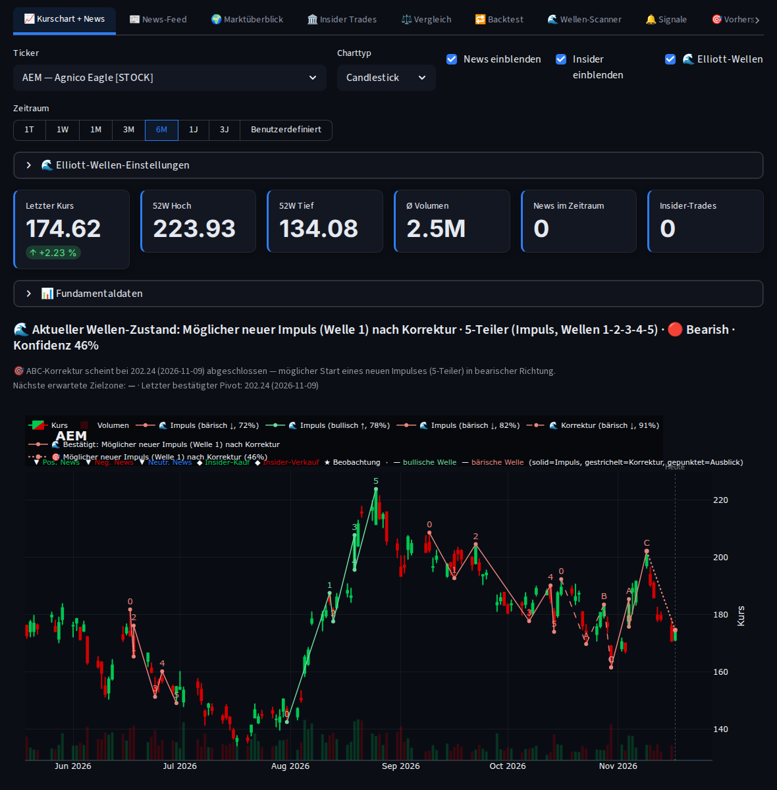
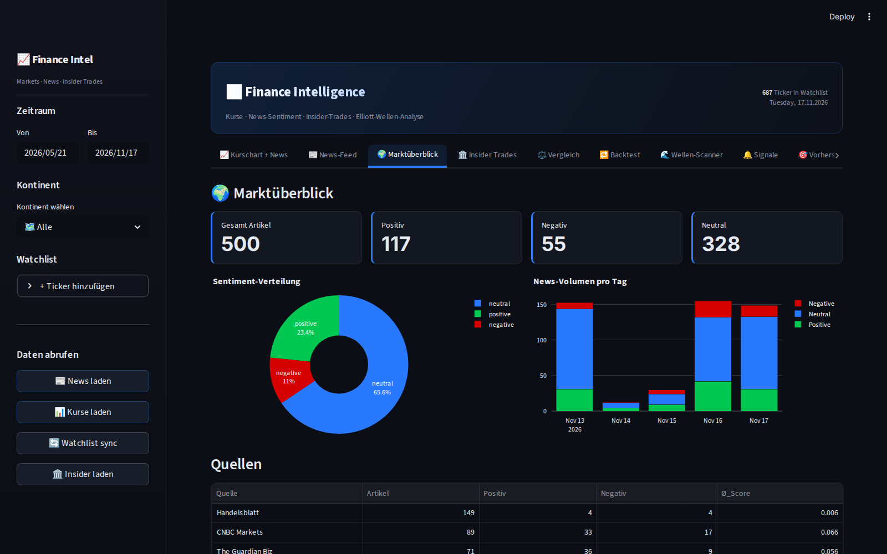
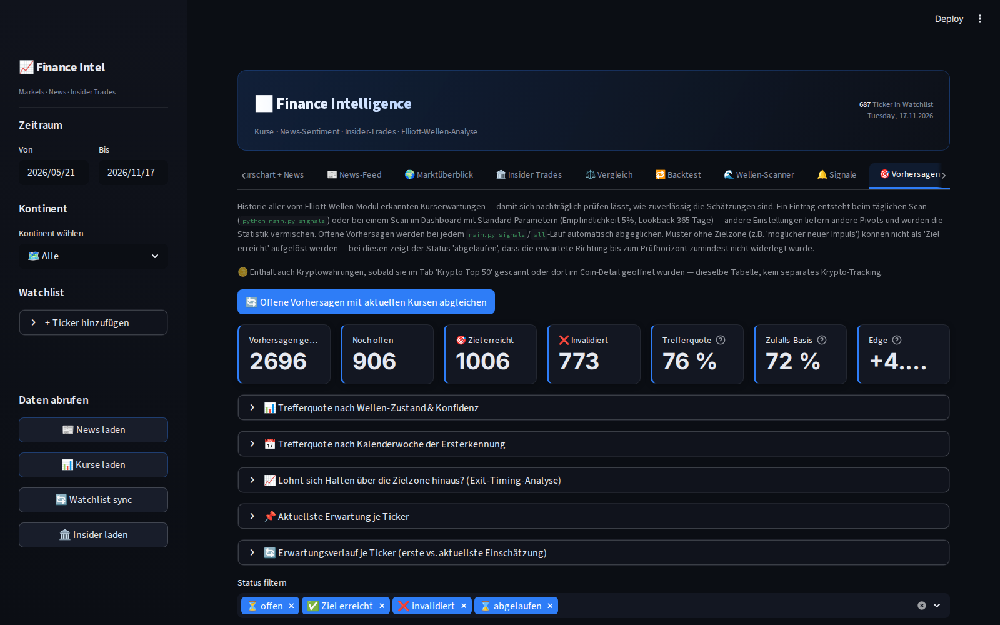

# Finance Intelligence: Marktdaten-Pipeline mit Analyse-Dashboard

Ein Werkzeug, das täglich Kurse, Wirtschaftsnachrichten und veröffentlichte Insider-Meldungen
aus mehreren öffentlichen Quellen sammelt, in einer SQLite-Datenbank zusammenführt und in einem
Streamlit-Dashboard auswertbar macht. Darauf aufbauend prüft es, ob regelbasierte Chartsignale
(Elliott-Wellen) einen messbaren Vorteil gegenüber dem Zufall haben, mit sauber getrennten
Trainings- und Testdaten.

> Lern- und Forschungsprojekt. Keine Anlageberatung, keine echten Orders.



| Marktüberblick: Nachrichten-Sentiment | Vorhersage-Protokoll: Trefferquote gegen Zufalls-Basis |
|---|---|
|  |  |

## Was das Projekt zeigt

- **Datenintegration:** acht Quellen mit unterschiedlichen Formaten (REST-APIs, RSS, SEC-EDGAR)
  werden normalisiert, dedupliziert und in einem gemeinsamen Datenmodell abgelegt.
- **Robuster Betrieb:** täglicher Lauf per Cron/anacron, `flock` verhindert parallele Schreibzugriffe
  auf die SQLite-Datenbank, Plausibilitätsprüfung verwirft fehlerhafte Kurse
  (z. B. falscher Coin unter gleichem Kürzel).
- **Saubere Auswertung:** Signalregeln werden auf 2016–2022 entwickelt und ab 2023 getestet,
  zusätzlich auf einem unabhängigen Test-Universum (452 Aktien außerhalb der Watchlist).
  Entscheidungsregeln werden festgelegt, bevor die Testdaten angesehen werden.
- **Tests:** 92 pytest-Tests für Datenbankschicht, Fetcher, Textverarbeitung, Backtest und Exit-Regeln.

## Architektur

```
                 ┌────────────────────── main.py (CLI, per Cron) ──────────────────────┐
 Quellen         │  fetchers/          processors/          analytics/                  │
 ───────         │  ─────────          ───────────          ──────────                  │
 yfinance ──────▶│  stock_fetcher      text_processor       elliott_wave, wave_tracker  │
 RSS-Feeds ─────▶│  news_fetcher       (Sentiment,          model_versions, backtest    │
 FMP (Kongress) ▶│  insider_fetcher     Ticker-Erkennung)   exit_rules, fundamentals    │
 arkfunds.io ───▶│  crypto_fetcher                                                      │
 SEC EDGAR ─────▶│  options_fetcher                                                     │
 CoinGecko ─────▶│                                                                      │
 Binance ───────▶│                                                                      │
 alternative.me ▶│                                                                      │
                 └───────────────────────────────┬──────────────────────────────────────┘
                                                 ▼
                                    SQLite (database/, 15 Tabellen)
                                                 ▼
                            Streamlit-Dashboard (dashboard/, 14 Tabs)
```

| Ordner | Aufgabe |
|---|---|
| `src/fetchers/` | Abruf je Quelle, einheitliches Ausgabeformat |
| `src/processors/` | News: Sentiment-Analyse, Erkennung genannter Unternehmen (Wortgrenzen + Sperrliste) |
| `src/database/` | Schema, Schreib-/Lesezugriffe, Kurshistorie, Plausibilitätsprüfung |
| `src/analytics/` | Elliott-Wellen-Erkennung, Signal-Versionen, Walk-forward-Rückrechnung, Backtests |
| `dashboard/` | Streamlit-Oberfläche: `app.py` baut die Seite, `tabs/` enthält je Tab ein Modul, dazu gemeinsame Bausteine (`data`, `charts`, `theme`, …) |
| `tests/` | pytest-Tests |
| `ERGEBNISSE/` | Protokolle der Auswertungen mit vorab festgelegten Entscheidungsregeln |

## Dashboard

- **Kurschart:** Candlestick mit News-Markern (nach Sentiment eingefärbt, anklickbar),
  Insider-Käufen/-Verkäufen am Handelstag und erkannten Wellenmustern samt Zielzonen
- **News-Feed, Marktüberblick, Vergleich** mehrerer Ticker (normierte Performance)
- **Insider Trades:** Meldungen von US-Kongressmitgliedern, ARK-Invest-Fonds und SEC-Form-4,
  Ranking nach Rendite seit Kauf, Backtest „was wäre, wenn man jeden Kauf mitgemacht hätte“
- **Wellen-Scanner, Signale, Vorhersagen:** laufende Muster, daraus abgeleitete Signale und deren
  spätere Überprüfung (Ziel erreicht / invalidiert / abgelaufen)
- **Modellvergleich, Papier-Trades:** Versionen der Signalregeln im Vergleich, simulierte
  100-€-Orders mit Stop-Loss und Gebühren
- **Krypto Top 50, Daytrading:** Kennzahlen und Intraday-Muster (15-Minuten-Kerzen)

## Auswertung (Auszug)

Ausgewertet wird die **Edge**: Trefferquote der Signale minus Trefferquote zufälliger Einstiege
(Zufalls-Basis). Rückrechnung über rund 45.000 Signale auf dem Test-Universum:

| Regel-Version | Training (bis 2022) | Test (ab 2023) |
|---|---|---|
| v1 · Original | +0,9 pp | +3,0 pp |
| v2 · nur Long | +4,9 pp | +8,1 pp |
| **v3 · evidenzbasiert (aktiv)** | **+5,4 pp** | **+7,8 pp** |

Rückrechnungen sagen nichts Sicheres über die Zukunft. Details, verworfene Varianten
(z. B. doppelter Einsatz im Bärenmarkt) und Gebühreneffekte stehen in `ERGEBNISSE/`.

## Installation und Start

Voraussetzung: Python ≥ 3.11.

```bash
./setup.sh                          # venv, Abhängigkeiten, NLTK-Daten, Datenbank anlegen
source venv/bin/activate

python main.py all                  # alle Daten abrufen und Signale berechnen
streamlit run dashboard/app.py      # Dashboard, http://localhost:8501
pytest                              # Tests
```

Weitere Befehle (`news`, `prices`, `insiders`, `signals`, `replay`, …) stehen am Anfang von
`main.py`. Für die Kongress-Meldungen ist ein kostenloser Schlüssel von
[Financial Modeling Prep](https://financialmodelingprep.com) nötig; er wird im Dashboard
eingegeben und lokal in `.insider_config.json` gespeichert (nicht im Repository).
Alle anderen Quellen funktionieren ohne Schlüssel.

Täglicher Lauf per Cron, z. B. werktags um 7 Uhr:

```
0 7 * * 1-5  /pfad/zu/finance-intel/cron_job.sh all
```

## Weitere Dokumentation

- `FUNKTIONEN.txt`: vollständige Funktionsübersicht
- `ELLIOTT_WELLEN.txt`: wie die Wellenerkennung arbeitet
- `VERBESSERUNGEN.txt`: umgesetzte und offene Verbesserungen

## Lizenz

MIT, siehe [LICENSE](LICENSE).
